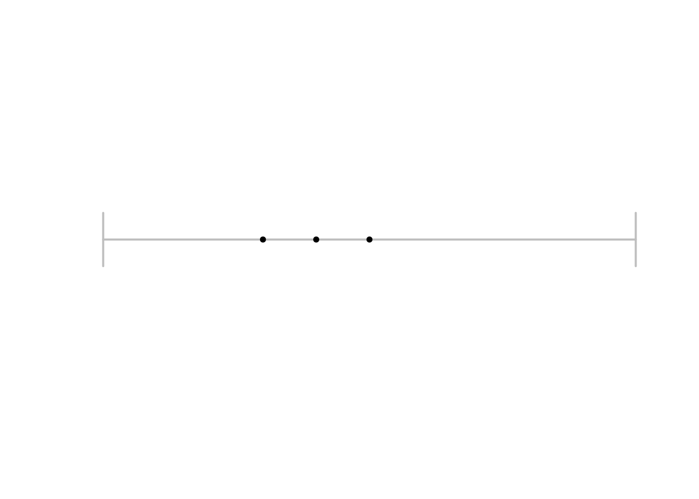
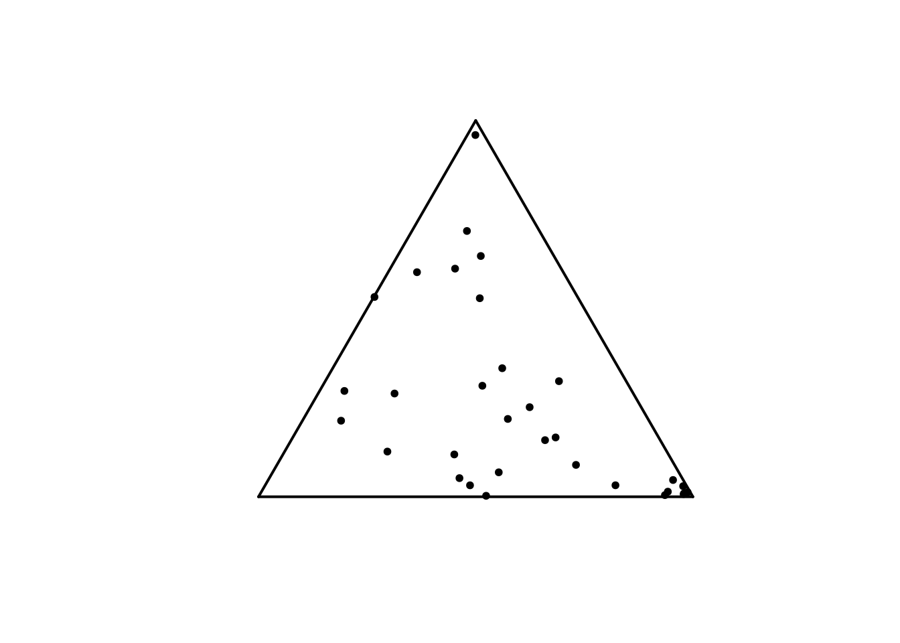
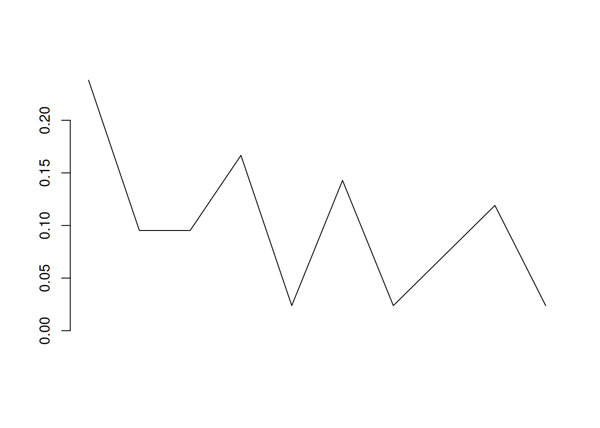
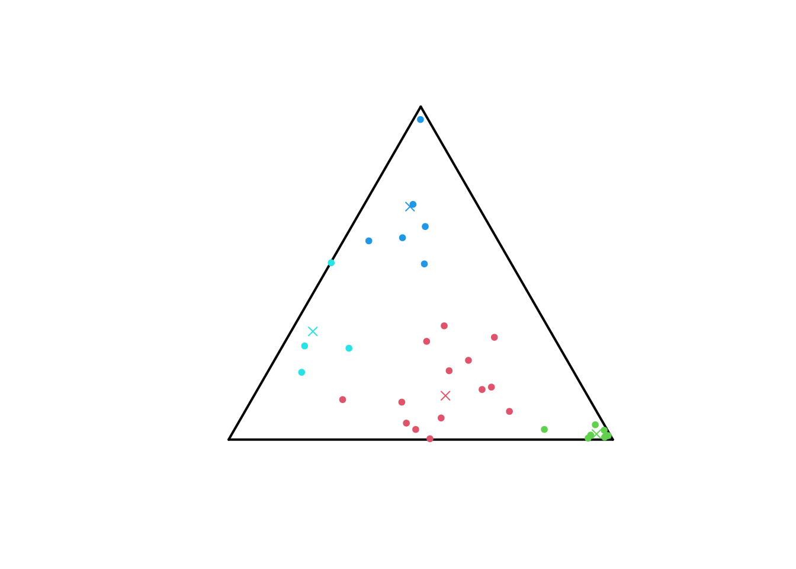
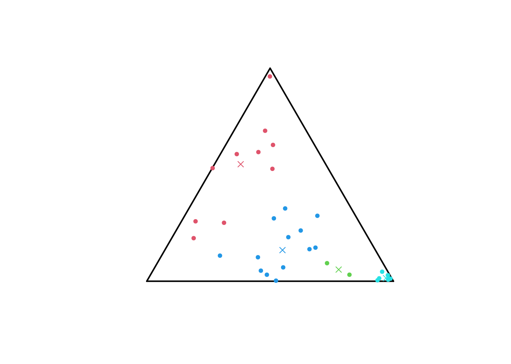

# Information-geometric centroids of categorical distributions

This tutorial is intended to assist the user in getting started with
calculating centroids of discrete (probability) distributions relative
to the Jeffreys and Jensen-Shannon divergences with the package
[igcentroids](https://github.com/pregnault/igcentroids.git) and
integrating these computation in a clustering-task workflow. It starts
with a short, technical presentation of the underlying S3 classes of R
objects the package is built upon, in
[Section 1](#sec-vig_catdist_presclasses). The information-geometric
theoretical foundation of the ensueing procedures is outlined in Setions
[2](#sec-vig_catdist_presdivergences) and
[3](#sec-vig_catdist_prescentroids). More precisely, the definitions and
properties of Kullback-Leibler (KL), Jeffreys (J) and Jensen-Shannon
(JS) divergences (div) and related centroids are reviewed; the usage of
methods for computing them is also illustrated. These procedures fully
integrate into a clustering-task workflow performed with the package
`{flexclust}`, as illustrated in
[Section 4](#sec-vig_catdist_clustering).

As a preliminary step, load the package
[igcentroids](https://github.com/pregnault/igcentroids.git), as follows.

``` r

library(igcentroids)
```

It is implicitly assumed that the package
[igcentroids](https://github.com/pregnault/igcentroids.git) has been
previously installed; if not, please, refer to the
[README](https://github.com/pregnault/igcentroids) file on top of the
repository of the package.

## S3 classes `igccatdist`, `igccatdistn`, `igcmatcatdist` and `igcmatcatdistn`

[igcentroids](https://github.com/pregnault/igcentroids.git) provides
several procedures for clustering categorical – or finite-state space –
(probability) distributions with same support.

We formally denote $`\mathcal{P}(\mathcal{X})`$ the set of positive
measures – or categorical distributions – on the finite set
$`\mathcal{X} = \{x_1, \cdots, x_d\}`$. Such a measure $`\mu`$ is
mathematically identifiable to the vector
$`(\mu(x_1), \cdots, \mu(x_d)) \in \mathbb{R}^d`$ with $`\mu(x_j) >0`$
for all $`j \in \{1, \cdots, d\}`$; it is represented in
[igcentroids](https://github.com/pregnault/igcentroids.git) as an object
of S3 class `igccatdist` built upon classical numeric vectors. Such an
object is obtained as the output of the eponyme constructor function
[`igccatdist()`](https://pregnault.github.io/igcentroids/reference/catdist.md),
taking a positive numeric vector as input.

``` r

set.seed(679)
# A positive measure on a 5-state space
p <- igccatdist(sample(1:10, size = 5L, replace = TRUE))
```

`igccatdist` objects are positive numeric vectors with two attributes
`class` and `mass`. The first one is obviously `"igccatdist"` while the
second is the mass of the whole set of states i.e., the sum of the
components of the vector. Both attributes are displayed when the object
is printed.

``` r

print(p)
#> [1] 8 2 8 3 5
#> attr(,"class")
#> [1] "igccatdist"
#> attr(,"mass")
#> [1] 26
```

Note that a validation function prevents the user to convert into
`igccatdist` non-positive vectors.

``` r

igccatdist(c(1, 0))
#> Error in `new_igccatdist()`:
#> ! all(p > 0) is not TRUE
igccatdist(-(1:3))
#> Error in `new_igccatdist()`:
#> ! all(p > 0) is not TRUE
```

The subset
$`\mathcal{P}_1(\mathcal{X}) \subset \mathcal{P}(\mathcal{X})`$ of
positive measures with mass equal to one is of foundamental interest in
any field related to probability theory. Its elements are probability
measures, called here normalized categorical distributions; they are
represented in
[igcentroids](https://github.com/pregnault/igcentroids.git) as objects
of class `igccatdistn`, unformally inheriting from `igccatdist`.

``` r

# The binomial distribution of parameters 
# n = 4 and p = 0.5 as an igccatdist object
q <- igccatdistn(dbinom(x = 0:4, size = 4L, prob = 0.5))
print(q)
#> [1] 0.0625 0.2500 0.3750 0.2500 0.0625
#> attr(,"class")
#> [1] "igccatdistn" "igccatdist" 
#> attr(,"mass")
#> [1] 1
# Normalize a positive vector prior to convert it to igccatdistn
p <- undo_igc(p) # Remove class igccatdist to retrieve a numeric vector
igccatdistn(p/sum(p))
#> [1] 0.30769231 0.07692308 0.30769231 0.11538462 0.19230769
#> attr(,"class")
#> [1] "igccatdistn" "igccatdist" 
#> attr(,"mass")
#> [1] 1
```

Sets of (normalized) categorical distributions on the same support are
represented as positive matrices – stochastic matrices for normalized
categorical distributions; dedicated classes are introduced in
[igcentroids](https://github.com/pregnault/igcentroids.git) :
`igcmatcatdist` and `igcmatcatdistn`.

``` r

matcd <- matrix(c(p, q), nrow = 2, byrow = TRUE)
igcmatcatdist(matcd)
#>        [,1] [,2]  [,3] [,4]   [,5]
#> [1,] 8.0000 2.00 8.000 3.00 5.0000
#> [2,] 0.0625 0.25 0.375 0.25 0.0625
#> attr(,"class")
#> [1] "igcmatcatdist"
#> attr(,"mass")
#> [1] 26  1
matncd <- matrix(c(p/sum(p), q), nrow = 2, byrow = TRUE)
igcmatcatdistn(matncd)
#>           [,1]       [,2]      [,3]      [,4]      [,5]
#> [1,] 0.3076923 0.07692308 0.3076923 0.1153846 0.1923077
#> [2,] 0.0625000 0.25000000 0.3750000 0.2500000 0.0625000
#> attr(,"class")
#> [1] "igcmatcatdistn" "igcmatcatdist" 
#> attr(,"mass")
#> [1] 1 1
```

The function
[`bind_igc()`](https://pregnault.github.io/igcentroids/reference/bind_igc.md)
eases the creation of `igcmatcatdist` or `igcmatcatdistn` objects by
binding together objects of classes `igc...`. Here are some examples,
the class of output depending on whether all inputs are normalized or
not.

``` r

# binding objects of classes igcmatcatdist and igcmatcatdistn
# results in an igcmatcatdist object.
matcd <- igcmatcatdist(matcd)
matncd <- igcmatcatdistn(matncd)
bind_igc(matcd, matncd)
#>           [,1]       [,2]      [,3]      [,4]      [,5]
#> [1,] 8.0000000 2.00000000 8.0000000 3.0000000 5.0000000
#> [2,] 0.0625000 0.25000000 0.3750000 0.2500000 0.0625000
#> [3,] 0.3076923 0.07692308 0.3076923 0.1153846 0.1923077
#> [4,] 0.0625000 0.25000000 0.3750000 0.2500000 0.0625000
#> attr(,"class")
#> [1] "igcmatcatdist"
#> attr(,"mass")
#> [1] 26  1  1  1
# Add a row to an igcmatcatdist object
r <- igccatdist(sample(1:10, size = 5L, replace = TRUE))
bind_igc(matcd, r)
#>        [,1] [,2]  [,3]  [,4]    [,5]
#> [1,] 8.0000 2.00 8.000  3.00  5.0000
#> [2,] 0.0625 0.25 0.375  0.25  0.0625
#> [3,] 1.0000 5.00 7.000 10.00 10.0000
#> attr(,"class")
#> [1] "igcmatcatdist"
#> attr(,"mass")
#> [1] 26  1 33
# Add a row to an igcmatcatdistn object
s <- igccatdistn(dbinom(0:4, size = 4L, prob = 0.3))
bind_igc(matncd, s)
#>           [,1]       [,2]      [,3]      [,4]      [,5]
#> [1,] 0.3076923 0.07692308 0.3076923 0.1153846 0.1923077
#> [2,] 0.0625000 0.25000000 0.3750000 0.2500000 0.0625000
#> [3,] 0.2401000 0.41160000 0.2646000 0.0756000 0.0081000
#> attr(,"class")
#> [1] "igcmatcatdistn" "igcmatcatdist" 
#> attr(,"mass")
#> [1] 1 1 1
```

Methods for generics
[`plot()`](https://rdrr.io/r/graphics/plot.default.html) and
[`points()`](https://rdrr.io/r/graphics/points.html) associated to
`igccatdistn` and `igcmatcatdistn` are available. Their behaviour
depends on the size $`|\mathcal{X}|`$ of the support $`\mathcal{X}`$.
More precisely, Two-state and three-state supports benefit of particular
representations, for mere of pedagogical purpose, as illustrated by
Figures [1 (a)](#fig-23statencdplot-1) and [1
(b)](#fig-23statencdplot-2).

``` r

# Two-state  categorical distributions plot
u <- c(0.5, 0.5)
p1 <- c(0.3, 0.7)
p2 <- c(0.4, 0.6)
x <- igcmatcatdistn(matrix(c(u, p1, p2),
                     nrow = 3, ncol = 2, byrow = TRUE))
plot(x)
# Three-state categorical distributions plot
runifsimplex <- function(n = 1L) {
  x <- runif(n)
  y <- runif(n, min = 0, max = 1-x)
  res <- igcmatcatdistn(matrix(c(x,y, 1-x-y), ncol = 3, byrow = FALSE))
  return(res)
}
set.seed(527)
sampsimp <- runifsimplex(n = 32L)
plot(sampsimp)
```



\(a\) Two-state probability distributions are represented as points on a
unite segment.



\(b\) Three-state probability distributions are represented as points in
the 2D simplex identified to the equilateral triangle.

Figure 1: Examples of representations of categorical probability
distributions obtained with the methods
[`plot()`](https://rdrr.io/r/graphics/plot.default.html) and
[`points()`](https://rdrr.io/r/graphics/points.html) for
`igcmatcatdistn` objects.

Categorical probability distributions with bigger state spaces are
represented as polylines i.e., continuous piecewise linear functions
linking the top of bars in a classical barplot; see
[Figure 2](#fig-plotbigstatespacencd).

``` r

p <- sample(1:10, size = 10L, replace = TRUE)
p <- igccatdistn(p/sum(p))
plot(p)
```



Figure 2: The barplot of a 10-state space probability distribution
presented as a polyline.

## Computing divergences of a couple of categorical distributions

Divergence functionals constitute a primal notion of information theory
and related fields. Among them, the Kullback-Leibler (KL) divergence of
two positive measures is of special theoretical and practical importance
due to its axiomatic, structural and geometric properties ; see, e.g
([Amari 2016](#ref-amari2016)). The KL divergence $`\mathbb{K}(p|q)`$ of
a couple $`(p, q) \in \mathcal{P}(\mathcal{X})^2`$ of positive measures
with same support is given by
``` math
\mathbb{K}(p|q) := \sum_{x \in \mathcal{X}} p(x) \log \frac{p(x)}{q(x)} - \sum_{x \in \mathcal{X}} p(x) + \sum_{x \in \mathcal{X}} q(x).
 \qquad(1)
```
Altought it is not a proper mathematical distance due to lack of
symmetry and triangular inequality, its numerous properties make it a
relevant measure of discrepancy between positive measures. First of all,
$`\mathbb{K}(p | q) \geq 0`$ for any couple $`(p, q)`$ and
$`\mathbb{K}(p | q)  = 0`$ if and only if $`p = q`$.

Restricted to the set of couples of probability distributions, the two
former sums in [Equation 1](#eq-defkldivposvec) cancel and the KL
divergence simplifies to
``` math
\mathbb{K}(p|q) = \sum_{x \in \mathcal{X}} p(x) \log \frac{p(x)}{q(x)}, \quad p, q \in \mathcal{P}_1(\mathcal{X}).
```
The KL divergence of two positive measures can be computed thanks to the
function
[`kldiv()`](https://pregnault.github.io/igcentroids/reference/kldiv.md)
of [igcentroids](https://github.com/pregnault/igcentroids.git):

``` r

set.seed(987)
# KL div for positive vectors
p <- igccatdist(sample(1:10, size = 5L, replace = TRUE))
q <- igccatdist(sample(1:10, size = 5L, replace = TRUE))
kldiv(p, q)
#> [1] 25.48113
kldiv(q, p) # KL is not symmetric
#> [1] 13.06366
# KL div for prob. dist.
p <- igccatdistn(dbinom(0:4, size = 4L, prob = 0.3))
q <- igccatdistn(dbinom(0:4, size = 4L, prob = 0.5))
kldiv(p, q)
#> [1] 0.3291315
```

To overcome the lack of symmetry – that appears to be a serious
disagreement for the use of KL divergence for clustering purpose –
several symmetrizations have been proposed in the litterature ([Nielsen
2019](#ref-nielsen2019entropy)). The Jeffreys and Jensen-Shannon
divergences are the two most notable such symmetrizations. Jeffreys
divergence of a couple of positive vectors, introduced in ([Jeffreys
1946](#ref-jeffreys1946)) is the sum of KL divergences of the couple
$`(p,q)`$ and its chiral version $`(q,p)`$:
``` math
\mathbb{J}(p, q) := \mathbb{K}(p | q) + \mathbb{K}(q | p) = \sum_{x \in \mathcal{X}} (p(x) -q(x)) \log \frac{p(x)}{q(x)}.
```
It is extensively used in machine and deep learning as a loss function
([Bousquet and Rouvier 2023](#ref-bousquetrouvier2023)), ([Nguyen et al.
2017](#ref-nguyenetal2017)), ([Nielsen 2013](#ref-nielsen2013)) and in
signal processing ([Saleh et al. 2018](#ref-griveletal2018)).

Jensen-Shannon (JS) divergence ([Lin 1991](#ref-lin1991)), whose first
appearance dates back to ([Wong and You 1985](#ref-wong1985)), is the
average of KL-divergences from each vector $`p`$ and $`q`$ with respect
to their arithmetic mean; more precisely,
``` math
\mathbb{JS}(p, q) := \frac{1}{2} \left( \mathbb{K}\left((p \Big| \frac{p+q}{2} \right) +  \mathbb{K}\left( q \Big| \frac{p+q}{2} \right) \right).
```
Besides its symmetry, JS divergence satisfies additionnal properties
that make it relevant in numerous applications: it can be defined for
categorical distributions with distinct supports, it always lies between
$`0`$ and $`\frac{1}{2}(p(\mathcal{X}) + q(\mathcal{X}))\log(2)`$ where
$`p(\mathcal{X})`$ and $`q(\mathcal{X})`$ denote the total weight of the
state space $`\mathcal{X}`$ ($`p(\mathcal{X}) = \sum_{x} p(x)`$) – this
upper bound being achieved when the supports $`p`$ and $`q`$ are
disjoint, and it can be expressed as the diferrence between the Shannon
entropy of the arithmetic mean of $`p`$ and $`q`$ and the arithmetic
mean of their Shannon entropies. Finally, the square root of
$`\mathbb{JS}`$ define a proper euclidean metric on
$`\mathcal{P}(\mathcal{X})`$; see ([Endres and Schindelin
2003](#ref-endresandschindelin2003)).

Jeffreys and JS divergences of two positive vectors or categorical
distributions can be computed thanks to the functions
[`jdiv()`](https://pregnault.github.io/igcentroids/reference/jdiv.md)
and
[`jsdiv()`](https://pregnault.github.io/igcentroids/reference/jsdiv.md)
in [igcentroids](https://github.com/pregnault/igcentroids.git).

``` r

set.seed(587)
# Jeffreys and JS divs for positive vectors
p <- igccatdist(sample(1:10, size = 5L, replace = TRUE))
q <- igccatdist(sample(1:10, size = 5L, replace = TRUE))
jdiv(p, q)
#> [1] 32.90188
jsdiv(p, q)
#> [1] 3.608267
# Jeffreys and JS divs for prob. dist.
p <- igccatdistn(dbinom(0:4, size = 4L, prob = 0.3))
q <- igccatdistn(dbinom(0:4, size = 4L, prob = 0.5))
jdiv(p, q)
#> [1] 0.6778383
jsdiv(p,q)
#> [1] 0.07907949
# Both are symmetric
all.equal(jdiv(q,p), jdiv(p,q))
#> [1] TRUE
all.equal(jsdiv(q,p), jsdiv(p,q))
#> [1] TRUE
```

Methods of
[`jdiv()`](https://pregnault.github.io/igcentroids/reference/jdiv.md)
and
[`jsdiv()`](https://pregnault.github.io/igcentroids/reference/jsdiv.md)
for positive matrices and stochastic matrices are also provided,
applying the above functions to all combinations of the rows of the two
input matrices and formatting the output as a numeric matrix.

``` r

mat1 <- bind_igc(p, q)
r <- igccatdistn(dbinom(0:4, size = 4L, prob = 0.4))
s <- igccatdistn(dbinom(0:4, size = 4L, prob = 0.2))
t <- igccatdistn(dbinom(0:4, size = 4L, prob = 0.1))
mat2 <- bind_igc(r, s, t)
jdiv(mat1, mat2)
#>           [,1]      [,2]     [,3]
#> [1,] 0.1767331 0.2155986 1.079941
#> [2,] 0.1621860 1.6635532 3.515559
jsdiv(mat1, mat2)
#>            [,1]       [,2]      [,3]
#> [1,] 0.02167791 0.02628537 0.1189825
#> [2,] 0.01993551 0.17639492 0.3147952
```

The second matrix input of
[`jdiv()`](https://pregnault.github.io/igcentroids/reference/jdiv.md)
and
[`jsdiv()`](https://pregnault.github.io/igcentroids/reference/jsdiv.md)
is optional; if not provided, it is implictly assumed to be equal to the
first one, making obvious the computation of the “distance” matrix of a
set of positive vectors or categorical distributions – which can further
be used as input of classical R functions for clustering; see
[Section 4](#sec-vig_catdist_clustering).

``` r

jdiv(mat2)
#>           [,1]      [,2]      [,3]
#> [1,] 0.0000000 0.7846634 2.1501114
#> [2,] 0.7846634 0.0000000 0.3243721
#> [3,] 2.1501114 0.3243721 0.0000000
jsdiv(mat2)
#>            [,1]       [,2]       [,3]
#> [1,] 0.00000000 0.09023812 0.21503708
#> [2,] 0.09023812 0.00000000 0.03876052
#> [3,] 0.21503708 0.03876052 0.00000000
```

## Computing centroids of a set of categorical distributions

Given a set
$`\{p^{(1)}, \cdots, p^{(n)}\} \subseteq \mathcal{P}(\mathcal{X})`$ of
$`n`$ positive vectors of size $`d`$ assorted with weights
$`\omega_1, \cdots, \omega_n`$, the Jeffreys and Jensen-Shannon
centroids $`c_{\mathbb{J}} = c_{\mathbb{J}}(p^{(1)}, \cdots, p^{(n)})`$
and $`c_{\mathbb{JS}} = c_{\mathbb{JS}}(p^{(1)}, \cdots, p^{(n)})`$ are
defined by
``` math
c_{\mathbb{J}}  :=  \textrm{Argmin}_{p \in \mathcal{P}(\mathcal{X})} \sum_{i=1}^n \omega_i \mathbb{J}(p, p^{(i)}),
 \qquad(2)
```
and
``` math
c_{\mathbb{JS}}  :=  \textrm{Argmin}_{p \in \mathcal{P}(\mathcal{X})} \sum_{i=1}^n \omega_i \mathbb{JS}(p, p^{(i)}).
 \qquad(3)
```
The opmitization set in the definitions ([2](#eq-defcentroids1)) and
([3](#eq-defcentroids2)) is restricted to the set of probability
distributions $`\mathcal{P}_1(\mathcal{X})`$ when
$`p^{(1)}, \cdots, p^{(n)}`$ are probability distributions; we denote
$`c_{\mathbb{J}}^{(1)}`$ and $`c_{\mathbb{JS}}^{(1)}`$ such centroids of
probability distributions so as to avoid confusion on the optimization
set under study.

Nielsen ([2013](#ref-nielsen2013)) establishes an explicit analytic
formula for Jeffreys centroid of positive vectors; precisely, it is
given by
``` math
c_{\mathbb{J}}(x) = \frac{a(x)}{\mathrm{W}\left( \frac{a(x)}{g(x)} e \right) }, \quad x \in \mathcal{X},
```
where $`a`$ and $`g`$ denote respectively the arithmetic and geometric
centroids given by
``` math
a(x) = \sum_{i=1}^n \omega_i p^{(i)}(x), \quad g(x) = \prod_{i=1}^n p^{(i)}(x)^{\omega_i}, \quad x \in \mathcal{X},
```
and $`\mathrm{W}`$ is the branch $`\mathrm{W_0}`$ of the Lambert
function, implicitly defined by $`\mathrm{W}(x)\exp(\mathrm{W}(x)) = x`$
for $`x \geq 0`$; see ([Nielsen 2013](#ref-nielsen2013)) for details.
This closed form of Jeffreys centroid of positive vectors is returned by
the method
[`jcent()`](https://pregnault.github.io/igcentroids/reference/jcent.md)
associated with the class `igcmatcatdist`. It returns an object of class
`igccatdist`, as illustrated in the following chunk.

``` r

set.seed(986)
p <- igccatdist(sample(1:10, size = 5L, replace = TRUE))
q <- igccatdist(sample(1:10, size = 5L, replace = TRUE))
jcent(bind_igc(p,q))
#> [1] 1.863589 6.853323 2.474680 5.207380 1.863589
#> attr(,"class")
#> [1] "igccatdist"
#> attr(,"mass")
#> [1] 18.26256
```

Note that the function `lambertW0()` of the package
[lamW](https://github.com/aadler/lamW) is used in the backend to compute
the Lambert function. Note also that dedicated functions
[`arithcent()`](https://pregnault.github.io/igcentroids/reference/arithcent.md)
and
[`geomcent()`](https://pregnault.github.io/igcentroids/reference/geomcent.md)
allows for computing arithmetic and geometric centroids of positive
vectors.

No closed form expression is known for Jeffreys centroid of probability
distributions. Five methods are implemented in
[igcentroids](https://github.com/pregnault/igcentroids.git) to compute
approximated values, as made explicit in the documentation of the method
[`jcent()`](https://pregnault.github.io/igcentroids/reference/jcent.md)
for `igcmatcatdistn` objects. In short, the argument `method` of
[`jcent()`](https://pregnault.github.io/igcentroids/reference/jcent.md)
identifies the numerical method to be performed by a character string.
The approximation returned by
[`jcent()`](https://pregnault.github.io/igcentroids/reference/jcent.md)
for `method = "bsa"` relies on the expression of
$`c_{\mathbb{J}}^{(1)}`$ derived by the Lagrangian method in ([Nielsen
2013](#ref-nielsen2013)):
``` math
c_{\mathbb{J}^{(1)}}(x) = \frac{a(x)}{\mathrm{W}\left( \frac{a(x)}{g(x)} \exp(\lambda +1) \right)}, \quad x \in \mathcal{X},
```
where $`\lambda \leq 0`$ is such that
$`c_{\mathbb{J}}^{(1)} \in \mathcal{P}_{1}(\mathcal{X})`$, with no
explicit expression for it. The value of $`\lambda`$ is then
approximated by a binary-search algorithm (bsa).

``` r

r <- igccatdistn(dbinom(0:4, size = 4L, prob = 0.4))
s <- igccatdistn(dbinom(0:4, size = 4L, prob = 0.2))
t <- igccatdistn(dbinom(0:4, size = 4L, prob = 0.1))
mat2 <- bind_igc(r, s, t)
jcent(mat2, method = "bsa",
      tol = 1e-8) # Precision of the bsa is controlled by tol
#> [1] 0.395958784 0.381942323 0.173819078 0.043506819 0.004772997
#> attr(,"class")
#> [1] "igccatdistn" "igccatdist" 
#> attr(,"mass")
#> [1] 1
```

Due to the numerous evaluations of the Lambert function involved in bsa
method, this method can be computationnaly expensive, particularly for
large state spaces $`\mathcal{X}`$. An alternative approach consists in
iteratively computing arithmetic and geometric means of centroids until
convergence. This method, refered to as Gauss-Bregman inductive
centering (gbic), has an informational geometric foundation, relying on
the dually flat structure of $`\mathcal{P}_1(\mathcal{X})`$ induced by
KL divergence; see Nielsen ([2024](#ref-nielsen2024)). Its excellent
performances make it the default method used by
[`jcent()`](https://pregnault.github.io/igcentroids/reference/jcent.md).
Three other methods are also provided, for sake of completeness and
comparison purposes.

``` r

jcent(mat2, # default corresponds to method = "gbic"
      tol = 1e-8) # tol controls state-by-state approximation error.
#> [1] 0.395919894 0.381836169 0.173814506 0.043597265 0.004832165
#> attr(,"class")
#> [1] "igccatdistn" "igccatdist" 
#> attr(,"mass")
#> [1] 1
```

Package `igcentroids` (version 0.0.1.0) covers the computation of
Jensen-Shannon centroids only for probability distributions. A numerical
approximation of $`c_{\mathbb{JS}}^{(1)}`$ is obtained by the
ConCave-Convexe Procedure (CCCP) introduced by ([Yuille and Rangarajan
2003](#ref-yuilleandrangarajan2003)), as stated in ([Nielsen
2020](#ref-nielsen2020)). See the documentation of the function
[`jscent()`](https://pregnault.github.io/igcentroids/reference/jscent.md)
for details.

``` r

jscent(mat2)
#> [1] 0.397343673 0.375236661 0.174943110 0.046764697 0.005711859
#> attr(,"class")
#> [1] "igccatdistn" "igccatdist" 
#> attr(,"mass")
#> [1] 1
```

## Clustering categorical distributions

[igcentroids](https://github.com/pregnault/igcentroids.git) provides
functions for an easy integration of these methods for clustering tasks
using the package `{flexclust}`, as illustrated by the following chunk
and [Figure 3](#fig-jjsclustering).

``` r

library("flexclust")
# Set jclust family: clustering based on 
# Jeffreys divergence and centroids
# Functions jdivflex(), jcentflex() and undo_igc()
# are included in {igcentroids}
# DO NOT MODIFY the following instruction
jfam <- kccaFamily(name = "jclust",
                   dist = jdivflex,
                   cent = jcentflex,
                   preproc = undo_igc)
# The same for Jensen-Shannon divergence and centroids
jsfam <- kccaFamily(name = "jsclust",
                   dist = jsdivflex,
                   cent = jscentflex,
                   preproc = undo_igc)
# Generate a set of random probability distributions
# Three-state categorical distributions plot
runifsimplex <- function(n = 1L) {
  x <- runif(n)
  y <- runif(n, min = 0, max = 1-x)
  res <- igcmatcatdistn(matrix(c(x,y, 1-x-y), ncol = 3, byrow = FALSE))
  return(res)
}
set.seed(527)
sampsimp <- runifsimplex(n = 32L)
# Operate clustering
res_jeffreys_clust <- kcca(x = sampsimp, 
                           k= 4, # Number of clusters
                           family = jfam)  
# Operate clustering
res_js_clust <- kcca(x = sampsimp, 
                     k= 4, # Number of clusters
                     family = jsfam)  
# Visualize Jeffreys clusters
plot(sampsimp, col = res_jeffreys_clust@cluster+1)
# Add centroids of clusters
points(igcmatcatdistn(res_jeffreys_clust@centers), 
       pch = 4, 
       col = 2:5)
# Visualize Jensen-Shannon clusters
plot(sampsimp, col = res_js_clust@cluster+1)
# Add centroids of clusters
points(igcmatcatdistn(res_js_clust@centers), 
       pch = 4, 
       col = 2:5)
```



\(a\) Clustering with Jeffreys divergence.



\(b\) Clustering with Jensen-Shannon divergence.

Figure 3: $`k`$-medoids clustering performed on a set of 32 randomly
generated probaiblity distributions on a three-state space, using
Jeffreys and Jensen-Shannon divergences and centroids as measures of
dissimarity and centers of classes.

We can compute the divergences between the probability distributions and
the centroids of the cluster, as illustrated below for the Jeffreys
clustering.

``` r

cents <- igcmatcatdistn(res_jeffreys_clust@centers) # Centroids
clusters <- split(1:nrow(sampsimp), res_jeffreys_clust@cluster)
jdiv2cents <- list(4)
for (i in 1:4) {
  jdiv2cents[[i]] <- jdiv(p = igcmatcatdistn(sampsimp[clusters[[i]],]), 
                          q = cents)
  colnames(jdiv2cents[[i]]) <- paste0("Centroid_", 1:4)
}
names(jdiv2cents) <- paste0("Cluster_", 1:4)
jdiv2cents
#> $Cluster_1
#>       Centroid_1 Centroid_2 Centroid_3 Centroid_4
#>  [1,] 0.04179681  1.4627622  1.1562806  1.1215317
#>  [2,] 0.13513820  1.7277522  2.4780415  1.3170095
#>  [3,] 0.53523277  1.4404718  4.7757247  2.6307397
#>  [4,] 0.18807317  1.5849733  2.8979431  1.6023330
#>  [5,] 0.05086308  0.9447104  1.6021936  1.6647139
#>  [6,] 0.15196904  0.5591045  2.2893058  2.2933588
#>  [7,] 0.10399919  1.3179992  1.0700267  1.3256607
#>  [8,] 0.08402536  0.8653833  1.5972523  1.7847049
#>  [9,] 0.25892925  1.9605293  0.6047796  0.9368975
#> [10,] 0.33862482  1.2621630  0.9428206  1.7266241
#> [11,] 0.05337381  1.2726543  2.2856323  1.5286908
#> [12,] 0.17427924  2.0451277  0.7215748  0.7551340
#> [13,] 0.06298114  1.8954377  1.7132045  0.9090367
#> [14,] 0.34775212  2.9823803  1.6943987  0.4620123
#> 
#> $Cluster_2
#>      Centroid_1  Centroid_2 Centroid_3 Centroid_4
#> [1,]  1.1762538 0.007547095   4.521785   4.870659
#> [2,]  1.2544066 0.033535451   5.298650   5.113569
#> [3,]  1.8335925 0.042377553   4.412256   5.916831
#> [4,]  1.7485681 0.019194765   5.303618   5.951605
#> [5,]  0.4653694 0.233081325   3.387479   3.293830
#> [6,]  1.3210977 0.031782600   3.763081   4.955200
#> [7,]  1.7726012 0.020084774   5.160121   5.966074
#> [8,]  2.1064831 0.050871191   5.169548   6.498406
#> 
#> $Cluster_3
#>      Centroid_1 Centroid_2   Centroid_3 Centroid_4
#> [1,]   1.576205   5.116070 0.1514593751  0.3379225
#> [2,]   1.635318   4.452160 0.0009273484  0.9430653
#> [3,]   4.246695   7.499680 0.6236321861  2.7844979
#> [4,]   1.253974   3.698391 0.0372771886  0.9635677
#> [5,]   0.797882   3.081353 0.1464568790  0.7678379
#> [6,]   1.196562   4.011474 0.0398383290  0.6123780
#> 
#> $Cluster_4
#>      Centroid_1 Centroid_2 Centroid_3  Centroid_4
#> [1,]  0.5119198   3.457708  0.8365206 0.151698243
#> [2,]  1.2399195   5.115600  1.0657271 0.009254796
#> [3,]  3.4750676   9.046286  0.8596527 0.344943580
#> [4,]  0.9565685   4.545494  1.3616577 0.085255848
```

## References

Amari, Shun-ichi. 2016. *Information Geometry and Its Applications*.
Springer.

Bousquet, Pierre-Michel, and Mickael Rouvier. 2023. “Jeffreys
Divergence-Based Regularization of Neural Network Output Distribution
Applied to Speaker Recognition.” *ICASSP 2023-2023 IEEE International
Conference on Acoustics, Speech and Signal Processing (ICASSP)*, 1–5.

Endres, Dominik Maria, and Johannes E Schindelin. 2003. “A New Metric
for Probability Distributions.” *IEEE Transactions on Information
Theory* 49 (7): 1858–60.

Jeffreys, Harold. 1946. “An Invariant Form for the Prior Probability in
Estimation Problems.” *Proceedings of the Royal Society of London.
Series A, Mathematical and Physical Sciences*, 453–61.

Lin, Jianhua. 1991. “Divergence Measures Based on the Shannon Entropy.”
*IEEE Transactions on Information Theory* 37 (1): 145–51.

Nguyen, Bac, Carlos Morell, and Bernard De Baets. 2017. “Supervised
Distance Metric Learning Through Maximization of the Jeffrey
Divergence.” *Pattern Recognition* 64: 215–25.

Nielsen, Frank. 2013. “Jeffreys Centroids: A Closed-Form Expression for
Positive Histograms and a Guaranteed Tight Approximation for Frequency
Histograms.” *IEEE Signal Processing Letters* 20 (7): 657–60.
<https://doi.org/10.1109/LSP.2013.2260538>.

Nielsen, Frank. 2019. “On the Jensen–Shannon Symmetrization of Distances
Relying on Abstract Means.” *Entropy* 21 (5): 485.

Nielsen, Frank. 2020. “On a Generalization of the Jensen–Shannon
Divergence and the Jensen–Shannon Centroid.” *Entropy* 22 (2).
<https://doi.org/10.3390/e22020221>.

Nielsen, Frank. 2024. “Fast Proxy Centers for the Jeffreys Centroid: The
Jeffreys–Fisher–Rao Center and the Gauss–Bregman Inductive Center.”
*Entropy* 26 (12). <https://doi.org/10.3390/e26121008>.

Saleh, Mahdi, Eric Grivel, and Samir-Mohamad Omar. 2018. “Jeffrey’s
Divergence Between Fractionally Integrated White Noises.” *2018 IEEE
Statistical Signal Processing Workshop (SSP)*, 139–43.
<https://doi.org/10.1109/SSP.2018.8450836>.

Wong, Andrew KC, and Manlai You. 1985. “Entropy and Distance of Random
Graphs with Application to Structural Pattern Recognition.” *IEEE
Transactions on Pattern Analysis and Machine Intelligence*, no. 5:
599–609.

Yuille, Alan L, and Anand Rangarajan. 2003. “The Concave-Convex
Procedure.” *Neural Computation* 15 (4): 915–36.
